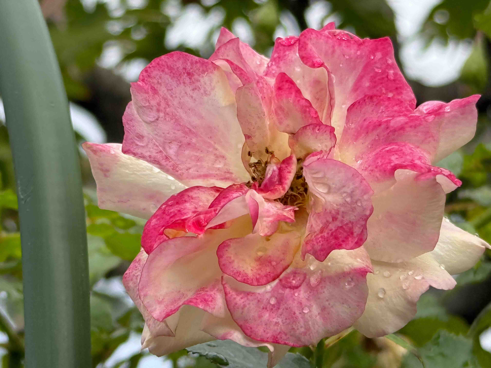
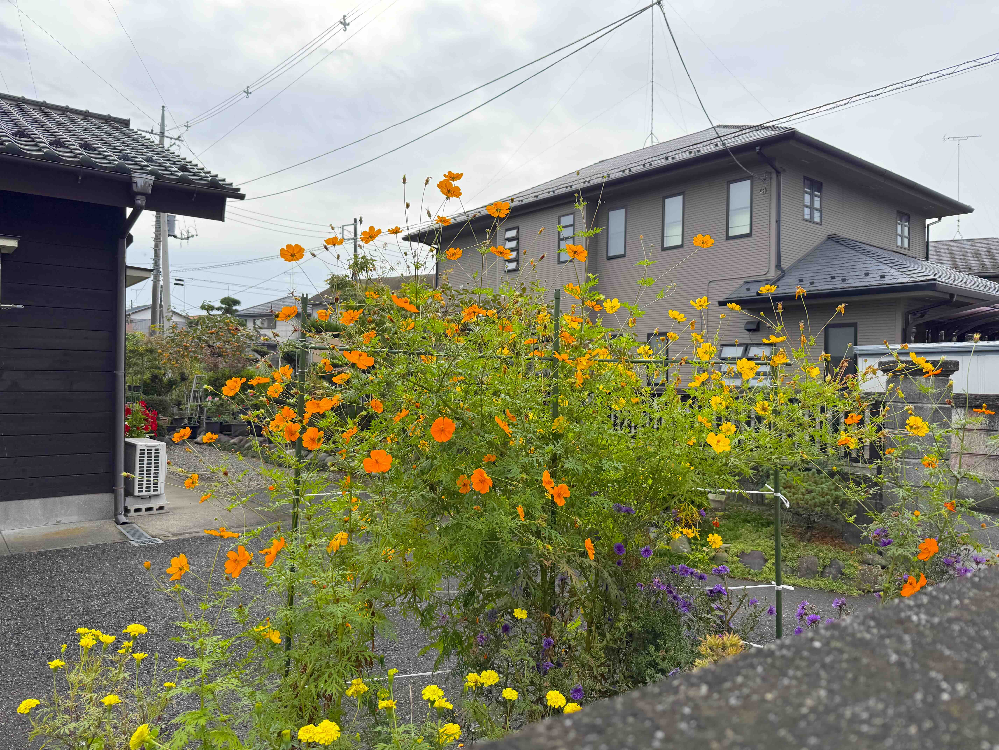
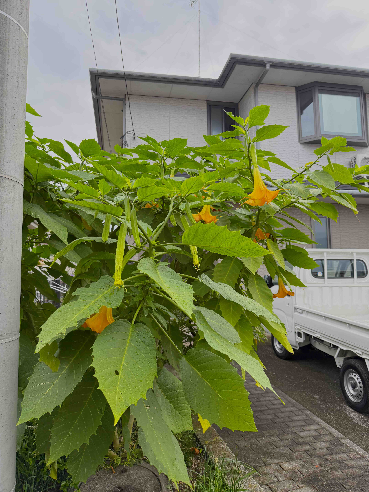
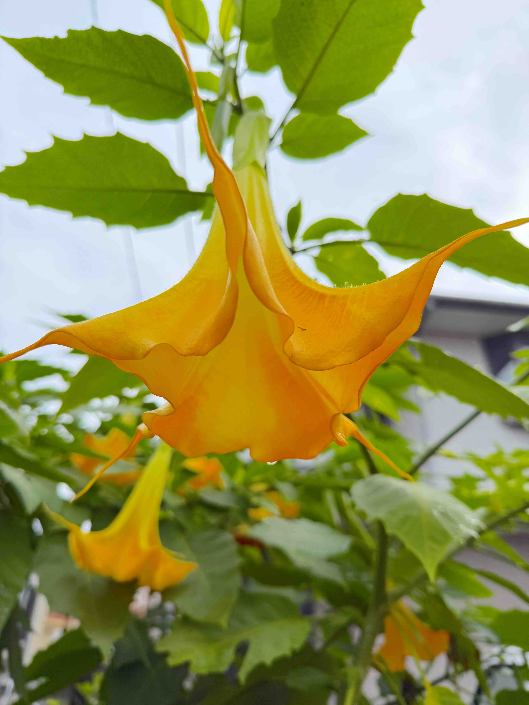
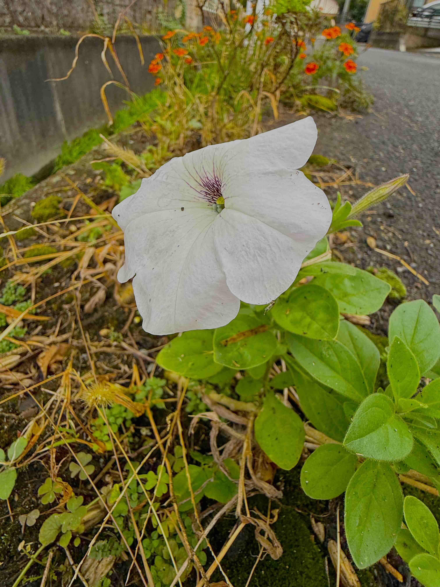
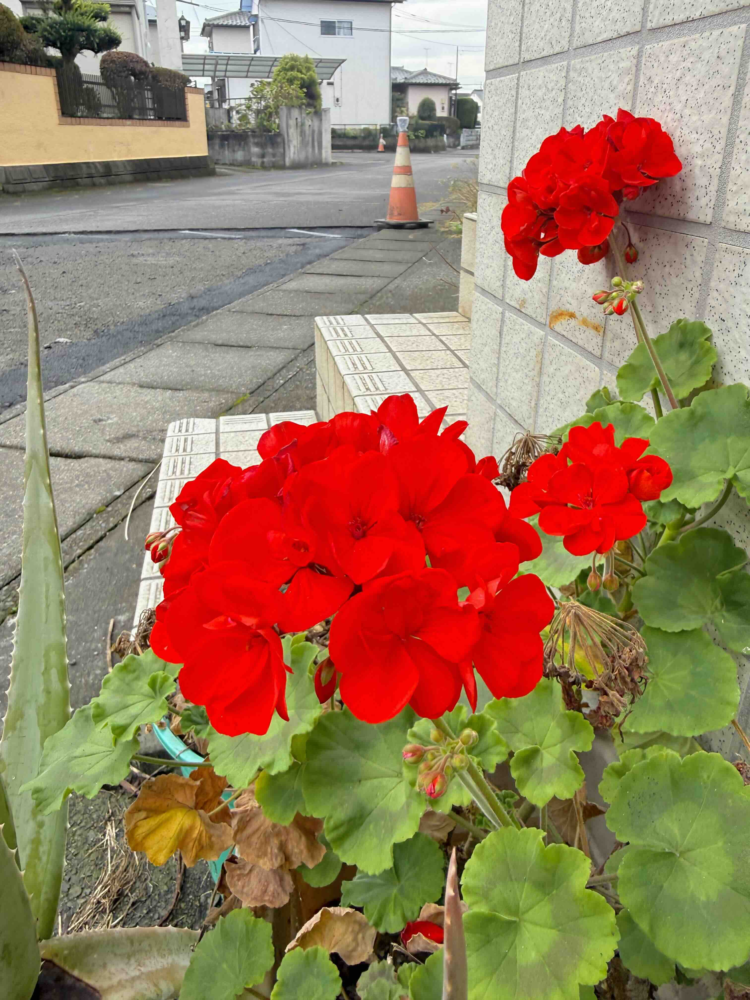
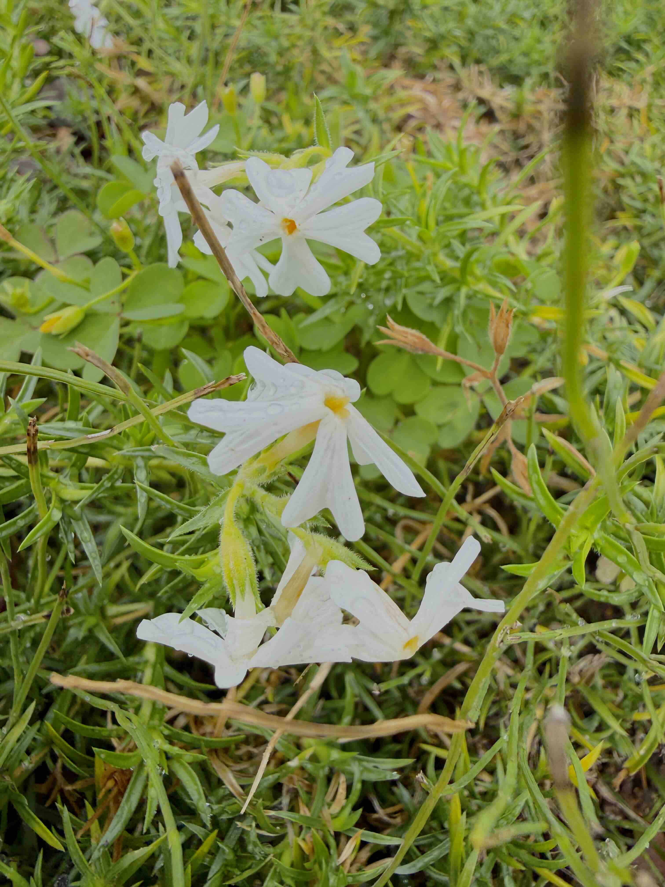
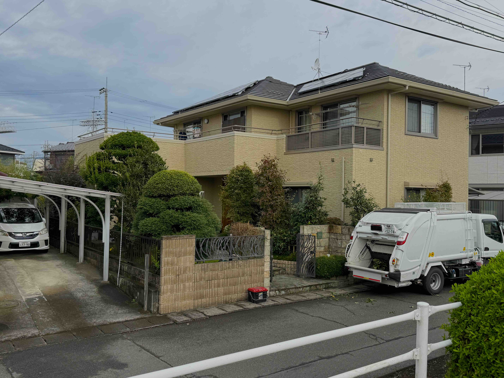
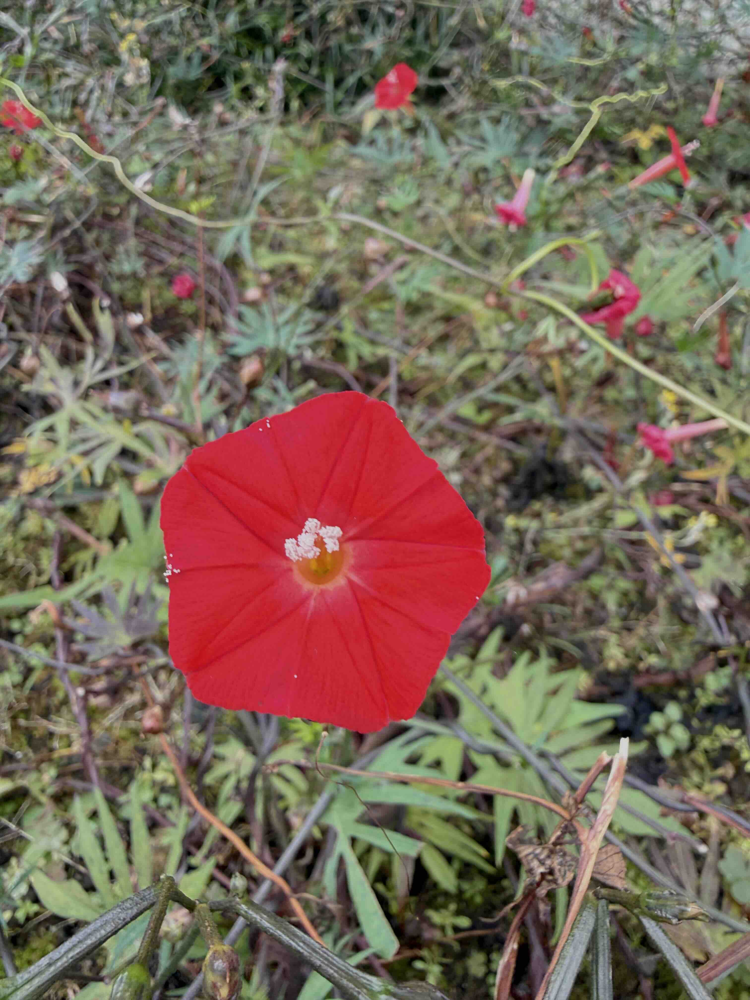

# 20261021_utsunomiya
<html lang="ja" data-loaded="false" data-scrolled="false" data-spmenu="closed">
<head>

<meta charset="UTF-8">
<meta http-equiv="Content-Type" content="text/html; charset=UTF-8">
<meta http-equiv="X-UA-Compatible" content="IE=EmulateIE10" />
<meta http-equiv="X-UA-Compatible" content="IE=edge">

<meta name="viewport" content="width=device-width, initial-scale=1.0">

<!--ここから上はお決まりの定型文です-->

<!--ここからが表現の書式などを決めるcssという部分-->

<link href="https://cdnjs.cloudflare.com/ajax/libs/lightbox2/2.7.1/css/lightbox.css" rel="stylesheet">

</head>

<body>

<!-- オープニング（スプラッシュ画面に写真とタイトルを配置） -->

  

    
    
最初の一枚はご近所の薔薇

  

<!-- メインコンテンツ -->

  <h1>メインのホームページ画像</h1>
  

<!--
    
<a href="https://peyng.github.io/restart/">前回までの記録</a>><a>今回2026,05,28</a>

-->

モバイル端末をお使いの場合は、画面を横向きにすると
背景画像の横方向がご覧頂けます。

<!--ここ上は、ほぼそのまま使います！-->

<!--QRコードの挿入例-->

 QR for Access

<marquee direction="left" scrollamount="20" width="30%">(^_^)/~alis</marquee>

<!--流れ文字の挿入例-->
<h1><marquee behavior="left">!!! 2026/10/21、ご近所のお花達から、ペットショップのワンちゃん達とお花屋さんのサボテンまで !!!</marquee></h1>

                          

<!--ここから下が、本体部分-->

<h2>2026Oct20、ご近所のコスモスが見事に満開</h2>

<h2>薔薇の花は雨に濡れてしっとり</h2>

<h2>キダチチョウセンアサガオも巨大な花を咲かせてニッコリ</h2>

<h2>玄関先のゼラニウムのお花が鮮やか</h2>

<h2>公園横の大先輩のお宅で、庭のお手入れ。葉っぱの処理で清掃車が来てました！</h2>

<h2>庭にアゲハ蝶の幼虫が居ました</h2>

<h2>ベルモールのペットショップ、ワンちゃん達の瞳がパッチリ</h2>

<h2>平日の火曜日なので、人出は少なめ</h2>

<h2>CDショップも空いてます</h2>

<h2>山下達郎と竹内まりやのコーナーが出来てました</h2>

<h2>FUJI ROCK FES '25 のレポート</h2>

<h2>CDショップの後はエスカレーター下って、本屋さんコース</h2>

<h2>この棚のチェックも定番ルート</h2>

<h2>お昼はいつものフードコートでお弁当</h2>

<h2>フードコート横のお花屋さんのお花達も元気に満開</h2>

<h2>サボテンも鮮やかにこんにちは</h2>

<!--
<h2>宇都宮市北部、カインズホームと吉野家までの走行経路はこのルート</h2>

-->

<h2>ベルモール地下駐車場への入庫と出庫走行動画</h2>

<iframe width="560" height="315" src="https://www.youtube.com/embed/jN2MTc4yarM?si=HgQ87fb84ZbrPtJl&autoplay=1&mute=1&loop=1&playlist=jN2MTc4yarM" title="YouTube video player" frameborder="0" allow="accelerometer; autoplay; clipboard-write; encrypted-media; gyroscope; picture-in-picture" allowfullscreen></iframe>
    

<h2>以上、今回は、お花達とワンちゃんとサボテンでした</h2>

  <!--
<h2>月齢の説明リンク貼ります</h2>
<h2><a href="https://starwalk.space/ja/moon-calendar" target="_blank">月齢カレンダー・リンク</a></h2>
-->
  
  

<h2>今日のBGMは、Piano Bamboo Water Sounds for Sleeping, Relaxation 24/7 自然の音とともに音楽をリラックス バンブーウォーターファウンテン</h2>

<iframe width="560" height="315" src="https://www.youtube.com/embed/oc2QEAnTjeU?si=4rNgvaZwl1i32wy-&autoplay=1&mute=0&loop=1&playlist=oc2QEAnTjeU" title="YouTube video player" frameborder="0" allow="accelerometer; autoplay; clipboard-write; encrypted-media; gyroscope; picture-in-picture" allowfullscreen></iframe>
    

   
<h2>2026Oct21、ご近所のお花達から、ペットショップのワンちゃん達とお花屋さんのサボテンまででした Thank you for reading this far.</h2>

   

<!-- hitwebcounter Code START -->
<a href="https://www.hitwebcounter.com" target="_blank">

you are visitor The numbers are cumulative for the Bangkok ＆ Utsunomiya series websites launched since 2025 August 1st.
</a>  

         

  

      

<!--本体はここまで-->
    

<!--画面に空白地帯を作って、背景が見えるようにしています-->
                                              

<!-- フッタ -->
<footer>

Copyright 2026/10/21 alis

</footer>

<!--HPにさまざまなJavaScriptを呼び込むための書式-->

    </body>
    
</html>
